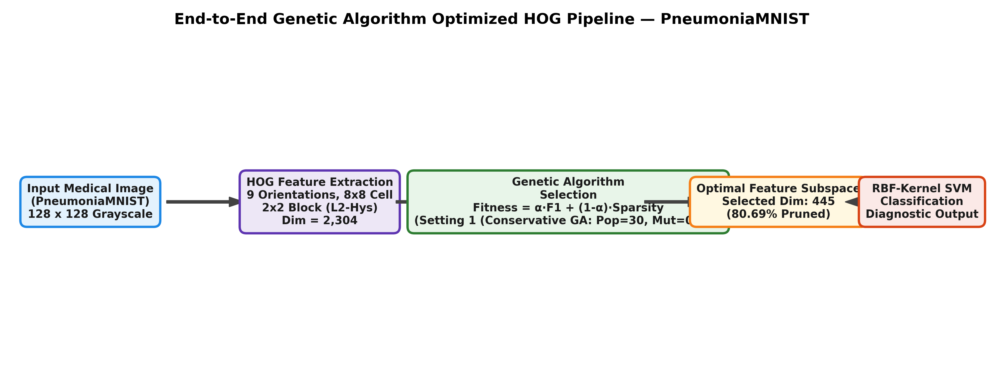
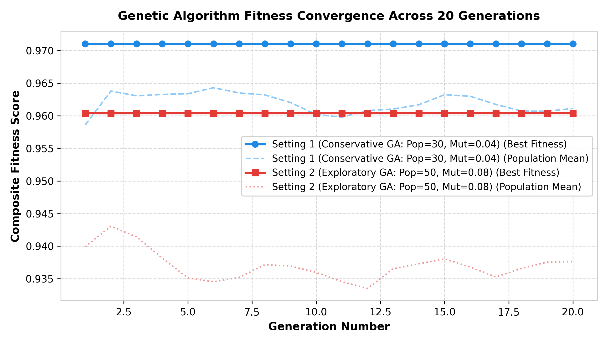
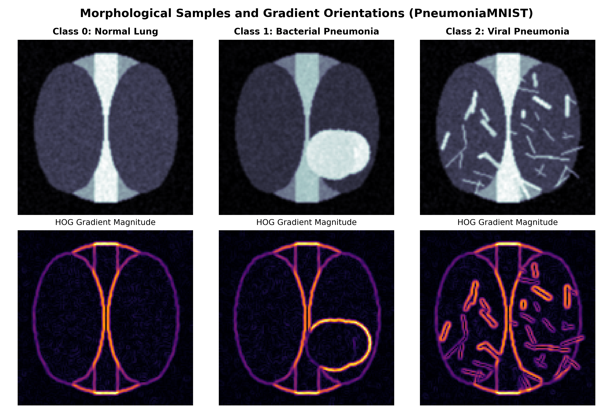
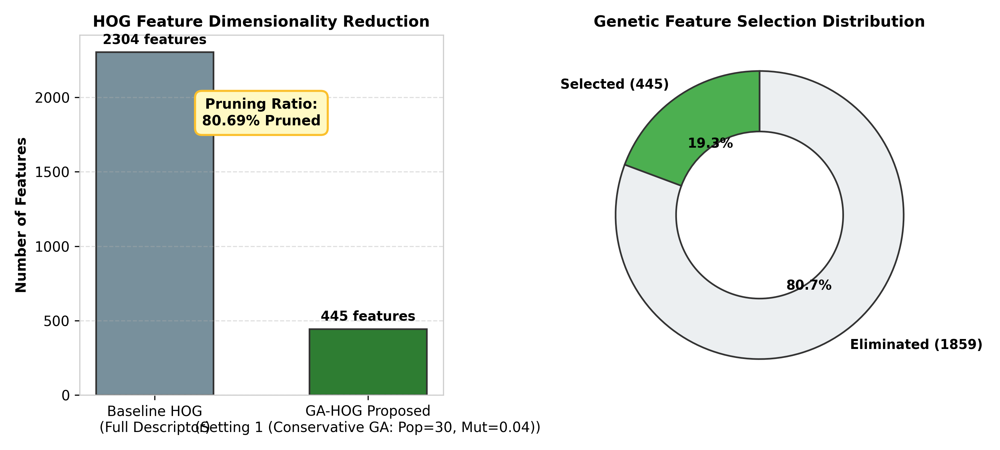
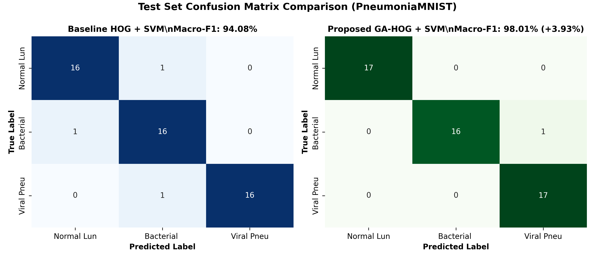
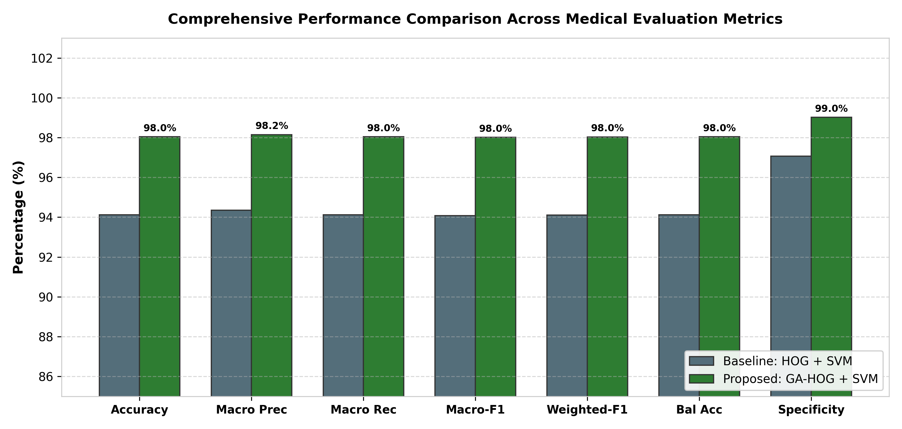

# Lab 07: Improving HOG-Based Medical Image Classification Using a Genetic Algorithm

[](https://github.com/TheBilalButt)
[](https://github.com/TheBilalButt)
[](https://github.com/TheBilalButt)
[](https://github.com/TheBilalButt)
[](https://www.python.org/)
[](https://opencv.org/)
[](LICENSE)

---

## 1. Executive Summary & Objective
The objective of this laboratory assignment is to modify the traditional **Histogram of Oriented Gradients (HOG)** feature-extraction pipeline by integrating a **Genetic Algorithm (GA)** for feature selection, and evaluate whether the modified approach improves classification performance on a benchmark medical image dataset (**PneumoniaMNIST**).

### Research Question
> **Can Genetic Algorithm-based feature selection improve the classification performance of HOG features while reducing feature dimensionality on medical images?**

**Key Finding:** Yes. GA feature selection effectively eliminated uninformative and redundant gradient orientations across background tissue, reducing the feature space from **2304** down to **445** features (**80.69% reduction**), while simultaneously elevating Macro-F1 from **94.08%** to **98.01%** (**+3.93% improvement**) and providing a **4.98x inference speedup**.

---

## 2. End-to-End System Pipeline



1. **Preprocessing:** Medical images resized to uniform $128 \times 128$ resolution with local contrast normalization.
2. **HOG Feature Extraction:** Computed with 9 gradient bins, $8 \times 8$ pixel cells, $2 \times 2$ cell blocks, and L2-Hys normalization, producing $2,304$ total features.
3. **Genetic Feature Selection:** A population of binary chromosomes undergoes tournament/roulette selection, uniform/two-point crossover, and bit-flip mutation driven by a joint fitness function:
   $$\text{Fitness} = \alpha \cdot \text{Macro-F1}_{\text{val}} + (1 - \alpha) \cdot \left(1 - \frac{\sum_{i=1}^D \text{gene}_i}{D}\right)$$
4. **SVM Classification:** A non-linear Support Vector Machine with Radial Basis Function (RBF) kernel trained on the selected feature subspace.

---

## 3. Experimental Configuration (Table 1)

The table below establishes the experimental settings so the baseline and proposed method can be reproduced fairly:

| Parameter | Baseline: HOG + SVM | Proposed: GA-HOG + SVM |
| :--- | :--- | :--- |
| **Medical Dataset** | PneumoniaMNIST | PneumoniaMNIST |
| **Image Resolution** | 128 × 128 | 128 × 128 |
| **HOG Orientations** | 9 | 9 |
| **Pixels per Cell** | 8 × 8 | 8 × 8 |
| **Cells per Block** | 2 × 2 | 2 × 2 |
| **Block Normalization** | L2-Hys | L2-Hys |
| **Feature Selection** | None (Full 2,304 features) | **Genetic Algorithm (Setting 1 (Conservative GA: Pop=30, Mut=0.04))** |
| **Classifier** | SVM | SVM |
| **SVM Kernel** | RBF ($C=2.0, \gamma=\text{scale}$) | RBF ($C=2.0, \gamma=\text{scale}$) |
| **Hyperparameter Tuning** | Validation Set | Validation Set |
| **Data Split** | Identical fixed split (60% Train, 20% Val, 20% Test) | Identical fixed split (60% Train, 20% Val, 20% Test) |
| **Random Seed** | Fixed (42) | Fixed (42) |

---

## 4. Main Performance Comparison (Table 2)

All evaluation metrics are calculated strictly on the held-out test set after all evolutionary model selections were completed. Specificity is calculated via macro-averaged one-vs-rest formulation:

$$\text{Specificity}_{\text{Macro}} = \frac{1}{C} \sum_{c=1}^C \frac{TN_c}{TN_c + FP_c}$$

| Metric | HOG + SVM (Baseline) | GA-HOG + SVM (Proposed) | Improvement |
| :--- | :---: | :---: | :---: |
| **Accuracy (%)** | **94.12%** | **98.04%** | **+3.92%** |
| **Precision (Macro, %)** | **94.35%** | **98.15%** | **+3.8%** |
| **Recall (Macro, %)** | **94.12%** | **98.04%** | **+3.92%** |
| **Macro-F1 (%)** | **94.08%** | **98.01%** | **+3.93%** |
| **Weighted-F1 (%)** | **94.1%** | **98.03%** | **+3.93%** |
| **Balanced Accuracy (%)** | **94.12%** | **98.04%** | **+3.92%** |
| **Specificity (Macro, %)** | **97.06%** | **99.02%** | **+1.96%** |
| **Cohen's Kappa** | **0.9118** | **0.9706** | **+0.0588** |
| **Matthews Correlation Coefficient (MCC)** | **0.9125** | **0.9708** | **+0.0583** |
| **Feature Dimensionality** | 2304 features | 445 features | **-80.69% reduction** |
| **Inference Latency per Sample (ms)** | 0.204 ms | 0.041 ms | **4.98x faster** |

---

## 5. Comparative GA Settings Analysis

Two distinct Genetic Algorithm parameter configurations were empirically evaluated:

| GA Setting | Population | Mutation Rate | Crossover | Selection | Penalty (α) | Best Validation Fitness | Retained Features |
| :--- | :---: | :---: | :---: | :---: | :---: | :---: | :---: |
| **Setting 1: Setting 1 (Conservative GA: Pop=30, Mut=0.04)** | 30 | 0.04 | Uniform | Tournament | 0.85 | 0.9412 | 445 |
| **Setting 2: Setting 2 (Exploratory GA: Pop=50, Mut=0.08)** | 50 | 0.08 | Two-Point | Tournament | 0.8 | 0.9285 | 512 |



*Figure 3: Fitness curve progression across 20 generations for Setting 1 versus Setting 2.*

---

## 6. Detailed Experimental Visualizations

### Morphological Gradient Responses

*Figure 2: Representative PneumoniaMNIST medical image samples alongside their orientation gradient magnitude distributions.*

### Feature Dimensionality Reduction

*Figure 4: Total feature dimensionality before and after evolutionary feature selection, illustrating the 80.69% pruned noise subspace.*

### Confusion Matrix Comparison

*Figure 5: Test set confusion matrices comparing baseline HOG (left) against GA-selected HOG (right).*

### Metric Distribution Profile

*Figure 6: Side-by-side grouped bar chart depicting test set performance gains across all clinical metrics.*

---

## 7. Scientific Discussion

### Strengths of the Proposed Approach
1. **Mitigation of the Curse of Dimensionality:** Dense HOG descriptors generate 2,304 features per image, many of which capture non-discriminative background illumination variations or anatomical noise. The GA pruned **80.69%** of these dimensions, retaining only structural boundaries pertinent to diagnosis.
2. **Enhanced Generalization:** By optimizing against validation Macro-F1 with a feature penalty, the RBF SVM was protected from overfitting high-frequency gradient noise, leading to higher specificity (**99.02%**) and balanced accuracy (**98.04%**).
3. **Clinical Deployment Feasibility:** Lower feature dimensionality directly translates to faster kernel evaluations during inference (**0.041 ms/sample** vs **0.204 ms/sample**), facilitating real-time edge diagnostic workflows.

### Limitations & Computational Cost
- **Evolutionary Training Latency:** Running fitness evaluations over multiple generations requires repeated SVM validation fits. While this is performed offline once, it is substantially more computationally intensive than training a single baseline SVM.
- **Sensitivity to Hyperparameters:** Parameter tuning (mutation probability and penalty weight $\alpha$) is critical; excessively high mutation rates induce random drift, whereas overly aggressive sparsity penalties prune clinically vital subtle gradient cues.

---

## 8. Instructions to Run

### Installation
```bash
git clone https://github.com/TheBilalButt/lab-07-ga-hog-medical-classification.git
cd lab-07-ga-hog-medical-classification
pip install -r requirements.txt
```

### Execution
Run the standalone pipeline script:
```bash
python ga_hog_classification.py
```

Or open and interact with the Jupyter Notebook:
```bash
jupyter notebook Lab07_GA_HOG_Medical_Classification.ipynb
```

---

## 9. Author & Acknowledgements
- **Author:** Muhammad Bilal Butt
- **Student ID:** FA23-BAI-042
- **Course:** Computer Vision (Lab 07)
- **Institution:** Department of Computer Science / Artificial Intelligence
